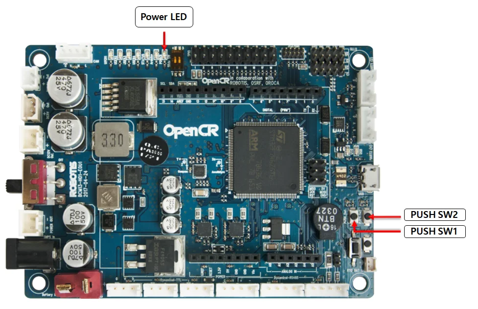

# Bootstrapping a TurtleBot3

This guide takes a TurtleBot3 from a fresh SD card to a configured Raspberry Pi with Docker installed and OpenCR flashed. It is normally a **one-time process per robot**. For the commands used at the start of each lab, see [Bringup](bringup.md).

We deliberately keep the host OS small. ROS 2 and the robot drivers run in Docker, so a broken or outdated ROS environment can be rebuilt without having to reinstall the entire Pi.

## 1. Prepare the SD card

You will need:

- A TurtleBot3 with a Raspberry Pi 4 and its OpenCR board.
- A **32 GB or larger microSD card**. Smaller cards have previously caused us avoidable storage problems.
- A computer with [Raspberry Pi Imager](https://www.raspberrypi.com/software/), and the lab Wi-Fi details.
- Access to the versioned TurtleBot package from [MAS Staff Releases](https://github.com/rusty-vibess/mas_staff/releases).

In Raspberry Pi Imager:

1. Select the correct Raspberry Pi model.
2. Choose **Raspberry Pi OS Lite, 64-bit** (under *Raspberry Pi OS (other)* in current Imager versions). We use Lite because the robot does not need a desktop environment.
3. Use a **Trixie** image. The bootstrap scripts explicitly check for Raspberry Pi OS Lite Trixie on `arm64`; a different OS release will fail rather than installing an untested dependency set.
4. Configure the Wi-Fi SSID and password, hostname, and an OS user. Our lab convention is the username `ubuntu`; use the password agreed for the lab.
5. Enable SSH with password authentication so you can connect after the first boot. The SSH password is the **OS user password**, not the Wi-Fi password.
6. Flash the card, insert it into the Pi and boot the robot.

Once it joins the network, SSH into the Pi using the account you configured. Do the remaining steps **on the TurtleBot**, not on the remote.

You can check the target OS before proceeding:

```bash
cat /etc/os-release
dpkg --print-architecture
```

You should see `VERSION_CODENAME=trixie` and `arm64`.

## 2. Obtain the TurtleBot package

Download the versioned TurtleBot `.tar.gz` asset from a **tagged GitHub Release** and transfer/extract it onto the Pi. Use the release package for lab robots, rather than cloning the current `main` branch.

Enter the extracted package directory containing `.env` and `Makefile`:

```bash
cd turtlebot3
make
```

`make` displays the available commands; it does not begin installation. Keep the `bootstrap/` directory alongside the Makefile and `.env`, since the scripts resolve their configuration relative to the package.

## 3. Set the initial configuration

Open `turtlebot3/.env` and check the bootstrap settings:

```dotenv
PACKAGE_VERSION=1.1.0
BOOTSTRAP_VERSION=1.0.1
BRINGUP_VERSION=1.0.0
OPENCR_PORT=/dev/ttyACM0
OPENCR_MODEL=burger
```

- `PACKAGE_VERSION` identifies the overall package release.
- `BOOTSTRAP_VERSION` selects the *host dependency and firmware snapshot*. It has its own version because the host setup can change independently of the ROS package.
- `BRINGUP_VERSION` identifies the bringup version; it does not select a configuration.
- `OPENCR_MODEL` must be either `burger` or `waffle`, matching the actual robot.
- `OPENCR_PORT` identifies the connected OpenCR board. `/dev/ttyACM0` is the default, not a guarantee for every Pi.

For bootstrap, terminal environment overrides take precedence over `.env`. For example:

```bash
OPENCR_MODEL=waffle make bootstrap
```

If you run the scripts directly, they use the same package `.env` and have their own defaults. You do not need to install ROS on the host.

## 4. Install Docker and flash OpenCR

Connect the OpenCR board over USB, then run:

```bash
make bootstrap
```

Run this **as your normal user**, without `sudo`. The script calls `sudo` for the operations that need it.

The setup script:

1. Checks the OS release, architecture, selected model and bootstrap snapshot.
2. Enables the `armhf` architecture and installs the recorded host prerequisites.
3. Removes conflicting Docker packages if present, then configures Docker's official Debian repository.
4. Installs Docker Engine, Compose and Buildx, enables Docker and adds the current user to the `docker` group.
5. Downloads the recorded ROS 2 OpenCR firmware, checks its SHA-256 and flashes the selected board.
6. Saves the flashed firmware commit/checksum to `/var/lib/turtlebot3/opencr-flash.conf` for later checking.

The default setup is **pinned**: `BOOTSTRAP_VERSION=1.0.1` selects `bootstrap/etc/bootstrap-v1.0.1.conf`. If this file is missing, incorrectly stamped or references unavailable package versions, installation fails. It will not silently substitute newer versions.

Once the script finishes, **log out and back in** so your new Docker group membership takes effect.

<!-- TODO: Add information about the --not-pinned option to run bootstrap with no version pinning, perhaps just a reference to that section, all distributed releases should contain a proper conf -->

### If the OpenCR flash fails

The updater will tell you how to enter recovery mode:

1. Hold **PUSH SW2**.
2. Press **RESET**, then release RESET.
3. Release PUSH SW2.
4. When the STATUS LED begins blinking, rerun `make bootstrap`.

Check `OPENCR_PORT` and the USB cable if the serial device is missing. Do not proceed as though the firmware was successfully flashed.

## 5. Perform the physical OpenCR test

This is the final manual part of bootstrap. Put the robot on flat ground with **at least one metre of clear space** and power the OpenCR board (red POWER LED lit).

1. Hold **PUSH SW1** for a few seconds. The robot should move forwards approximately 30 cm.
2. Hold **PUSH SW2** for a few seconds. The robot should rotate approximately 180°.



These are physical movement tests, so keep hands, cables and obstacles clear. The official [ROBOTIS OpenCR test instructions](https://docs.robotis.com/docs/systems/turtlebot3/quick_start_guide/opencr_setup/?ros=humble#opencr-test) include more information.

## 6. Verify the installation

After logging back in, run:

```bash
make check
```

This compares installed packages with the configured snapshot, checks that the **recorded** OpenCR commit/checksum matches it, and smoke-tests Docker, Compose and Buildx.

Importantly, the OpenCR check reads the record saved when the script flashed the board; it **does not interrogate the firmware currently on the board**. The physical test above remains important.

If `make check` passes, the host has been bootstrapped. You can now configure the robot-specific ROS settings and follow [Bringup](bringup.md).

## Updating the bootstrap baseline

Most users should **not** need this section. Use the pinned snapshot shipped with the release when preparing lab robots.

When intentionally creating a *new* dependency/firmware baseline:

1. Choose a new `BOOTSTRAP_VERSION` in `.env` (for example `1.0.2`). Do not reuse an existing version.
2. Adjust package definitions or the firmware reference in `bootstrap/etc/bootstrap-version.conf` as required.
3. Resolve and install that baseline:

   ```bash
   make bootstrap BOOTSTRAP_ARGS=--not-pinned
   ```

4. Confirm the robot works and passes its physical OpenCR test.
5. Export the versions actually installed and flashed, then check them:

   ```bash
   make export
   make check
   ```

`make export` creates `bootstrap/etc/bootstrap-v<BOOTSTRAP_VERSION>.conf`. It **will not overwrite** an existing snapshot. Commit/distribute the new snapshot with the next package release and retain earlier snapshots as records of previously deployed robots.

`--not-pinned` is a baseline-creation tool, not a workaround when a pinned installation fails.

## Before moving to bringup

Check the remaining values in `.env`: `ROS_DOMAIN_ID`, `ROBOT_NAME`, `LDS_MODEL`, `LDS_DEVICE`, `CMD_VEL_GUARD` and `MANAGED_GATEWAY`. These govern the running ROS system rather than the one-time host installation; [Bringup](bringup.md) explains their roles.
